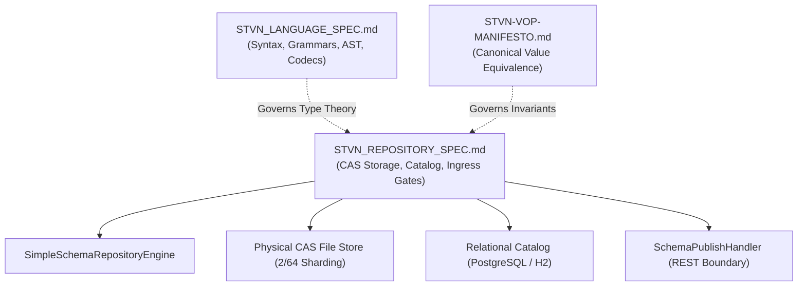
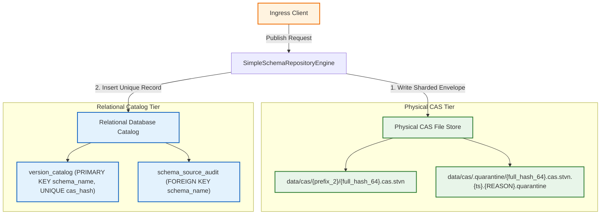
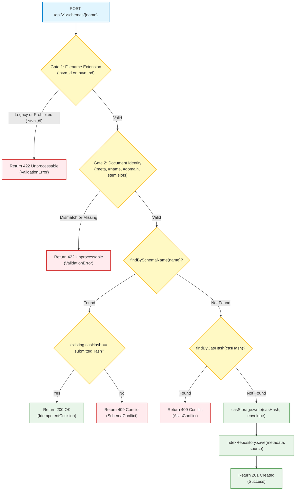

# STVN Architecture Specification: Schema Repository Server & CAS Catalog Invariants

**Document ID:** `STVN-SPEC-REPO-02`  
**Status:** Canonical Architecture Specification  
**Version:** `2.0.0`  
**Target Repository:** `ij_stvnadore_repository` (`stvnadore-repository`)  
**Target Version Baseline:** `2.0.0-SNAPSHOT`  
**Governing Standard:** Simplified Technical English (STE-01 through STE-07)  
**Foundational Baselines:** `STVN_LANGUAGE_SPEC.md` (v2.0.0), `STVN-VOP-MANIFESTO.md`  

---

## 1. Scope & Ecosystem Authority

### 1.1 The Ecosystem Role of the Schema Repository

The STVN Schema Repository (`stvnadore-repository`) provides authoritative Content-Addressable Storage (CAS) and relational indexing services for the Strongly Typed Value Notation (STVN) ecosystem. The repository acts as the single source of truth for compiled schemas, nominal type declarations, Document Identity (`:meta`), and binary wire framing contracts.



### 1.2 Division of Architectural Authority

The STVN ecosystem divides architectural governance between two authoritative specifications:

1. **`STVN_LANGUAGE_SPEC.md` Governance Scope:**
   - Syntax and formal ANTLR grammar definitions (`StvnLexer.g4`, `StvnParser.g4`).
   - Abstract Syntax Tree (AST) definitions, intermediate representations (`StvnValue`), and lowering rules.
   - Document Identity (`:meta`) grammar, metadata control bytes, and hermetic definition schemas.
   - Standard library prelude declarations (`:org/stvnadore/prelude/*`).
   - Binary serialization strategies (`BinaryEncodingStrategy`), Byte 4 and Byte 5 framing, and memory-mapped reader APIs.

2. **`STVN_REPOSITORY_SPEC.md` Governance Scope:**
   - Physical Content-Addressable Storage (CAS) envelope formatting and sharded directory layouts (`.cas.stvn`).
   - Relational catalog schema design (`version_catalog`, `schema_source_audit`), domain indexing, and unique constraint invariants.
   - HTTP ingress boundary gates (Gate 1 filename hygiene, Gate 2 document identity verification), payload sanitization, capacity bounds, and diagnostic status mappings.
   - Nominal identity hashing and the Nominal Bijectivity Invariant ($1:1$ Law).
   - Forensic recovery, projection sweeping, and quarantine protocols (`.quarantine`).

### 1.3 Strict Payload & Intermediate File Exclusions (Non-Goals)

The schema repository is strictly a Content-Addressable Storage (CAS) registry for nominal schema definitions. It is NOT an arbitrary document or payload database.

The following document categories are strictly excluded from repository ingestion:
1. **Instance Data Documents (`.stvn`, `.stvn_b`):** Contain runtime data values. Data instances must never be registered in the schema catalog.
2. **Modular Schema Definitions (`.stvn_di`):** Contain `:include` directives. Clients must flatten modular schemas into hermetic definition units prior to publication (`ERR_INCLUDES_PROHIBITED_IN_FLAT_DOCUMENT`).
3. **Excised Legacy File Extensions (`.stvn_incl`, `.stvn_inclf`, `.stvn_cas`, `.stvn_bin`):** Permanently prohibited under Matrix v2026.10.09a (`ERR_LEGACY_FILE_EXTENSION_PURGED`).

The repository accepts exclusively hermetic, flattened definition schema units:
- `.stvn_d` for canonical text definitions.
- `.stvn_bd` for self-describing binary definitions.

---

## 2. The Nominal Bijectivity Invariant ($1:1$ Law)

### 2.1 The Bijectivity Theorem

In the STVN ecosystem, nominal typing makes schema identity an intrinsic component of the schema value. Physical wire formats, specifically Binary Encoding Strategy `0x7` (`ExplicitSha256`), transmit a 32-byte cryptographic hash in the stream header to identify the framing schema. Wire decoders resolve the schema by looking up this hash in the repository.

To guarantee deterministic wire decoding and prevent type confusion, the repository enforces a strict bijection between nominal schemas and CAS hashes:

$$f: \text{NominalSchema} \longleftrightarrow \text{CAS Hash}$$

Under this theorem:
1. Every distinct nominal schema maps to exactly one deterministic SHA-256 CAS hash.
2. Every SHA-256 CAS hash maps to exactly one authoritative nominal schema name.

### 2.2 Opaque Nominal Preimage Invariant

Two schemas with identical physical layouts but distinct nominal type names or identities produce distinct CAS addresses. For example:

```stvn
# Schema A: UserIdentity.stvn_d
{
  :meta {
    #name "UserIdentity"
    #domain "identity"
    #kind #DEFS
  }
  :defs {
    :UserId { #size 64 #unsigned } :Int
  }
}
```

```stvn
# Schema B: AccountIdentity.stvn_d
{
  :meta {
    #name "AccountIdentity"
    #domain "identity"
    #kind #DEFS
  }
  :defs {
    :AccountId { #size 64 #unsigned } :Int
  }
}
```

Both schemas define a 64-bit unsigned integer. However, `:UserId` and `:AccountId` represent distinct domain concepts. Furthermore, their `:meta` blocks declare distinct `#name` values.

The repository mandates that `StvnSchemaFlattener` incorporate the collapsed hermetic `:meta` block, fully qualified nominal identifier, namespace path, and metadata facets into the SHA-256 digest preimage using zero-bracket padding. Consequently:

$$\text{SHA-256}(\text{UserIdentity.stvn\_d}) \neq \text{SHA-256}(\text{AccountIdentity.stvn\_d})$$

### 2.3 Binary Strategy `0x7` Resolution Invariant

Binary Strategy `0x7` wire framing requires exact schema resolution. When a decoder receives a binary payload with Byte 4 Bit 7 set and an `ExplicitSha256` header, the decoder executes:

$$\text{GET /api/v1/schemas/cas/}\{hash\}$$

The endpoint must return the exact schema associated with that hash. If the repository permitted multiple nominal schema names to register the same content hash, the resolution would become non-deterministic. Non-deterministic resolution violates Value-Oriented Programming (VOP) Canonical Equivalence and causes deserialization failures.

---

## 3. Dual-Tier Storage Architecture

The repository coordinates two persistence tiers: the immutable physical Content-Addressable Storage (CAS) tier and the relational metadata catalog tier.



### 3.1 Physical CAS Storage Tier

The physical CAS tier stores immutable schema envelope files on the filesystem.

#### 3.1.1 2/64 Hexadecimal Sharding Layout
CAS addresses consist of 64-character lowercase hexadecimal SHA-256 digests. To avoid filesystem directory scaling limits, the storage engine partitions files into a two-level hierarchy using full 64-character hash stems:
- **Prefix Directory:** The first 2 characters of the hash (`[0-9a-f]{2}`).
- **Payload File:** The full 64-character hash with the `.cas.stvn` extension (`[0-9a-f]{64}.cas.stvn`).

```
<CAS_ROOT>/
├── 4a/
│   └── 4a1f8b3c...e890.cas.stvn
├── 7b/
│   └── 7b09c2a1...4412.cas.stvn
└── .quarantine/
    └── 9e28...11.cas.stvn.1791663751.CORRUPT_ENVELOPE.quarantine
```

#### 3.1.2 CAS Envelope Document Format
Physical CAS files do not store bare source code. Files store an authoritative STVN document called the CAS envelope. The envelope records Document Identity (`#domain "cas"`, `#kind #BODY`), the nominal schema filename, verification tag, and source code:

```stvn
{:meta{#name "4a1f8b3c...e890"#domain "cas"#kind #BODY}:defs{:SchemaName :String :StvnDef{#preserveIndent #T}:String}:type :Tuple(:SchemaName :StvnDef):body ("customer_profile.stvn_d" """[SHA256-4a1f8b3c...e890]
{:meta{#name "customer_profile"#domain "crm"#kind #DEFS}:defs{:CustomerId {#size 64 #unsigned} :Int :CustomerName {#minSize 1 #maxSize 128} :String}}
[SHA256-4a1f8b3c...e890]""")}
```

Envelope documents conform to STVN 2.0.0 standards:
- Root `:meta` declares `#name "<full_hash_64>"`, `#domain "cas"`, and `#kind #BODY`.
- Boolean facets use canonical short forms (`#T`).
- Braces are zero-bracket padded without internal whitespace padding.

### 3.2 Relational Catalog Tier

The relational catalog indexes schema identities to support fast metadata queries and enforce ecosystem uniqueness constraints.

#### 3.2.1 Table: `version_catalog`
The `version_catalog` table maintains the active index of registered schemas:

```sql
CREATE TABLE IF NOT EXISTS version_catalog (
    schema_name      VARCHAR(255) NOT NULL,
    domain           VARCHAR(255) NOT NULL DEFAULT 'default',
    shape_signature  TEXT         NOT NULL,
    cas_hash         VARCHAR(64)  NOT NULL,
    created_at       TIMESTAMP WITH TIME ZONE DEFAULT CURRENT_TIMESTAMP,
    CONSTRAINT pk_version_catalog PRIMARY KEY (schema_name),
    CONSTRAINT uq_version_catalog_cas_hash UNIQUE (cas_hash)
);

CREATE INDEX IF NOT EXISTS idx_version_catalog_shape ON version_catalog (shape_signature);
CREATE INDEX IF NOT EXISTS idx_version_catalog_domain_name ON version_catalog (domain, schema_name);
```

#### 3.2.2 Mandate for `uq_version_catalog_cas_hash`
The `CONSTRAINT uq_version_catalog_cas_hash UNIQUE (cas_hash)` constraint is mandatory. It enforces the Nominal Bijectivity Invariant ($1:1$ Law) at the database tier:
1. **Namespace Spoofing Prevention:** Prevents a malicious actor from publishing an existing schema's content under an unauthorized schema name.
2. **Alias Hijacking Defense:** Ensures that a single cryptographic hash maps to exactly one nominal schema name.
3. **Deterministic Wire Resolution:** Guarantees that downstream binary decoders resolve Strategy `0x7` wire frames to a unique schema.

#### 3.2.3 Table: `schema_source_audit`
The `schema_source_audit` table maintains an immutable historical audit log of every publish attempt:

```sql
CREATE TABLE IF NOT EXISTS schema_source_audit (
    audit_id         BIGINT GENERATED ALWAYS AS IDENTITY PRIMARY KEY,
    schema_name      VARCHAR(255) NOT NULL,
    cas_hash         VARCHAR(64)  NOT NULL,
    source_text      TEXT         NOT NULL,
    created_at       TIMESTAMP WITH TIME ZONE DEFAULT CURRENT_TIMESTAMP,
    CONSTRAINT fk_schema_source_audit_schema FOREIGN KEY (schema_name)
        REFERENCES version_catalog (schema_name) ON DELETE RESTRICT
);

CREATE INDEX IF NOT EXISTS idx_schema_source_audit_hash ON schema_source_audit (cas_hash);
```

---

## 4. Ingress State Machine & Conflict Calculus

When a client submits a schema to `POST /api/v1/schemas/{name}`, the repository executes the Ingress State Machine.



### 4.1 Ingress Conflict Calculus Matrix

The table below specifies the outcome for every combination of `schema_name` and `cas_hash` in `version_catalog`:

| Existing `schema_name` | Existing `cas_hash` | Outcome Variant | HTTP Status | Relational Action | Explanation |
|:---|:---|:---|:---|:---|:---|
| **Absent** | **Absent** | `PublishResult.Success` | `201 Created` | Insert catalog row; write CAS envelope blob. | New unique schema registered successfully. |
| **Present** | **Identical** | `PublishResult.IdempotentCollision` | `200 OK` | No database write; return existing metadata. | Re-submitting identical schema is an idempotent success. |
| **Present** | **Different** | `PublishResult.SchemaConflict` | `409 Conflict` | Reject; rollback transaction. | Schemas are immutable. Updating existing names is prohibited. |
| **Absent** | **Present** | `PublishResult.AliasConflict` | `409 Conflict` | Reject; rollback transaction. | CAS hash already claimed by another schema name ($1:1$ Law violation). |
| **N/A** | **Corrupt / Invalid** | `PublishResult.ValidationError` | `422 Unprocessable` | Reject; zero disk or database modifications. | Schema failed compiler or structural validation gates. |

---

## 5. Ingress Gates & Presentation Sanitization

The repository enforces a multi-stage defense perimeter before computing digests or touching persistence tiers.

### 5.1 Perimeter Capacity Bounds
Ingress handlers reject payloads exceeding `StvnVocabulary.DEFAULT_UNBOUNDED_STRING_CAPACITY` ($16\text{ MiB} = 16{,}777{,}216\text{ bytes}$) with HTTP 422:
```json
{
  "error": "Capacity Overflow",
  "message": "ERR_CAPACITY_OVERFLOW: Payload exceeds maximum allowed capacity: 16777216 units"
}
```

### 5.2 Gate 1: Filename Extension Hygiene

Schema filenames must strictly end with `.stvn_d` (for text) or `.stvn_bd` (for binary). The repository enforces fail-closed perimeter rejection on all other extensions:
- `.stvn_di` $\rightarrow$ Rejected (`ERR_INCLUDES_PROHIBITED_IN_FLAT_DOCUMENT`).
- Excised legacy extensions (`.stvn_incl`, `.stvn_inclf`, `.stvn_cas`, `.stvn_bin`) $\rightarrow$ Rejected (`ERR_LEGACY_FILE_EXTENSION_PURGED`).
- Instance payloads (`.stvn`, `.stvn_b`) $\rightarrow$ Rejected (`ERR_MALFORMED_SCHEMA_IN_ENVELOPE`).
- Bare dotfiles or extensions without visible stems $\rightarrow$ Rejected (`ERR_INVALID_FILENAME_STEM`).

### 5.3 Gate 2: Document Identity & Bijectivity Enforcement

Schemas must explicitly declare Document Identity:
1. **Mandatory `:meta` Block:** Schemas must possess a `:meta` block. If absent, the engine terminates with diagnostic `ERR_SCHEMA_IDENTITY_MISMATCH`.
2. **Explicit `#name` and `#domain`:** Both `#name` and `#domain` must be non-empty strings matching `^[a-zA-Z0-9_-]{1,64}$`. Anonymous wildcards trigger rejection `ERR_SCHEMA_IDENTITY_MISMATCH`.
3. **Mandatory `#kind #DEFS`:** Schemas must declare `#kind #DEFS`. Omitting or mismatching `#kind` triggers `ERR_DOCUMENT_KIND_MISMATCH`.
4. **Stem Slot 0 Matching:** The declared `#name` must strictly match envelope schema stem slot 0 (`<name>` in `<name>.<domain>.stvn_d` or `<name>.stvn_d`).
5. **Stem Slot 1 Domain Verification:** If the schema filename includes domain in slot 1 (`<name>.<domain>.stvn_d`), the declared `#domain` must strictly match slot 1.

### 5.4 Gate 3: Canonical CAS Hashing & Preimage Calculation

The CAS hash preimage is computed over the canonical flattened schema text including `:meta` using the frozen `SHORT_FORM`, `FORCE_EXPLICIT`, zero-bracket padded profile emitted by `StvnSchemaFlattener`.

### 5.5 Flat Schema AST Structure Invariant

Schemas published to the repository must declare flat definitions only:
- The root document must contain strictly a `:defs` section.
- Top-level `:type` and `:body` sections are prohibited.
- `:include` directives inside flat schemas are prohibited (`ERR_INCLUDES_PROHIBITED_IN_FLAT_DOCUMENT`).

---

## 6. Forensic Reconciliation & Projection Sweeper

The repository includes a background worker (`RelationalProjectionSweeper`) to reconcile on-disk CAS files with the relational catalog.

### 6.1 Sweeper Reconciliation Lifecycle

The projection sweeper operates on a virtual thread:
1. **Directory Enumeration:** Scans `<CAS_ROOT>` and enumerates all `.cas.stvn` and legacy `.stvn_cas` files.
2. **Index Check:** Checks `indexRepository.existsByHash(casHash)`. If present, skips the file.
3. **Envelope Parsing:** Reads the physical envelope and unpacks `(schemaName, innerSourceText)`.
4. **Validation Re-run:** Compiles `innerSourceText` using `StvnCompiler.compileToResult(STRICT)`.
5. **AST Verification:** Verifies AST structure invariants, mandatory `:meta`, and recalculates the flattened SHA-256 digest.
6. **Hash Confirmation:** Compares the computed digest with the filename hash.
7. **Projection Restoration:** If valid, writes the restored record to `version_catalog` and `schema_source_audit`.

### 6.2 Forensic Quarantine Isolation

If a file in CAS storage fails any verification step, the sweeper isolates the file immediately. The sweeper moves the file to `<CAS_ROOT>/.quarantine/` using an atomic file move:

$$\text{<CAS\_ROOT>/.quarantine/<full\_hash\_64>.cas.stvn.<timestamp>.<REASON>.quarantine}$$

#### Quarantine Failure Reasons:
- `EMPTY_PAYLOAD`: Physical file contains zero bytes.
- `CORRUPT_ENVELOPE`: File failed STVN envelope parsing.
- `INVALID_TUPLE_FORMAT`: Envelope structure does not match `:Tuple(:SchemaName :StvnDef)`.
- `INVALID_FILENAME_EXTENSION`: Embedded schema name does not end with `.stvn_d`.
- `INVALID_INNER_AST`: Inner schema failed semantic compilation or contains raw tabs.
- `ILLEGAL_INCLUDES_IN_FLAT_SCHEMA`: Inner schema contains prohibited `:include` directives.
- `MALFORMED_INNER_STRUCTURE`: Inner schema contains top-level `:type` or `:body`.
- `FLATTENING_ERROR`: Flattening engine failed to produce canonical shape signature.
- `HASH_MISMATCH`: Recalculated SHA-256 digest does not match the physical filename hash.

---

## 7. Compliance Verification Checklist

Implementations of `stvnadore-repository` must satisfy this verification checklist to achieve compliance with `STVN-SPEC-REPO-02`:

- [x] **Check 1 (Nominal Bijectivity):** Enforce `CONSTRAINT uq_version_catalog_cas_hash UNIQUE (cas_hash)` in database DDL.
- [x] **Check 2 (Alias Conflict Pre-check):** Check `findByCasHash(casHash)` during publication. Return `PublishResult.AliasConflict` (HTTP 409) if hash exists under a different name.
- [x] **Check 3 (Idempotent Collision):** Return `PublishResult.IdempotentCollision` (HTTP 200) only when both schema name and hash match.
- [x] **Check 4 (Schema Mutation Conflict):** Return `PublishResult.SchemaConflict` (HTTP 409) when schema name exists with a different hash.
- [x] **Check 5 (Fail-Closed Intake):** Reject raw tabs, legacy compound tokens, and `#size` on `:String` with HTTP 422.
- [x] **Check 6 (Envelope Modernization):** Package envelopes using `:meta{#name "<casHash>"#domain "cas"#kind #BODY}`, `:Tuple(:SchemaName :StvnDef)`, and `.stvn_d`.
- [x] **Check 7 (Forensic Quarantine):** Relocate corrupt or tampered CAS files to `.quarantine/` with diagnostic tags.
- [x] **Check 8 (Relational Domain Column):** Persist and query `domain VARCHAR(255)` with compound index `(domain, schema_name)`.
